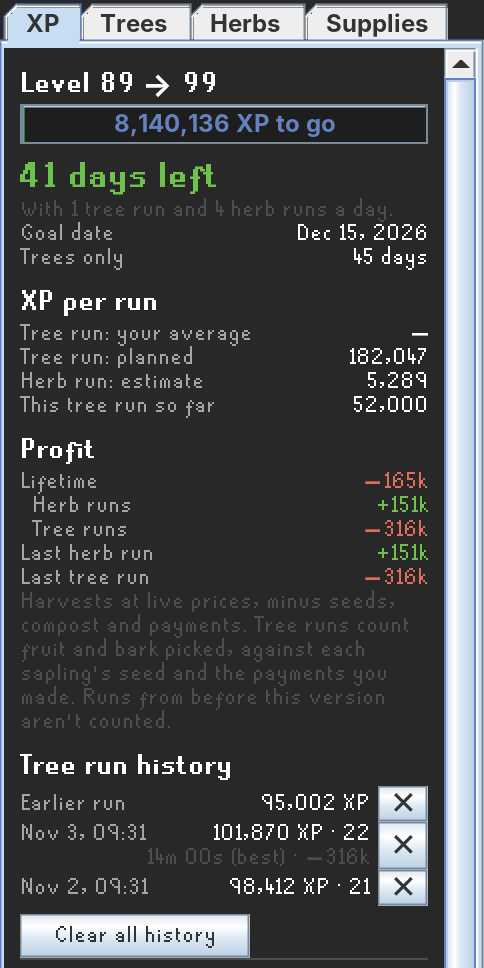
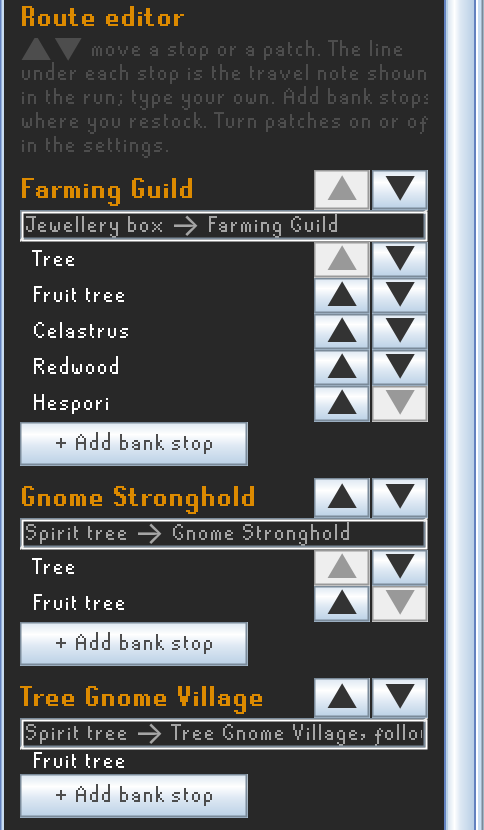
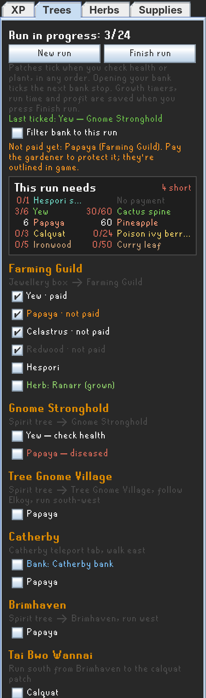
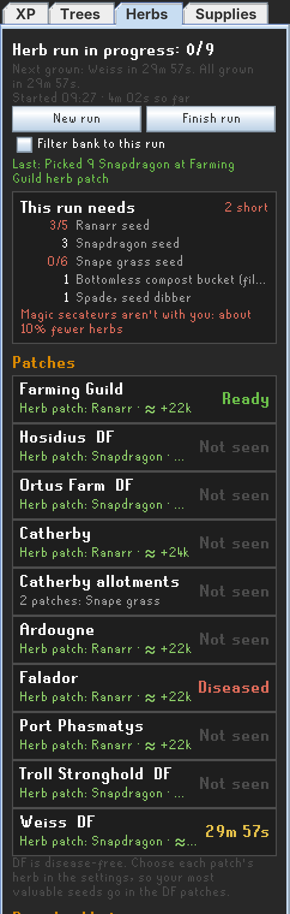
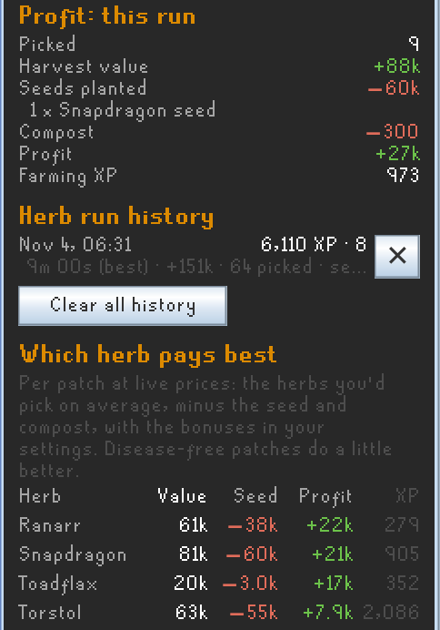
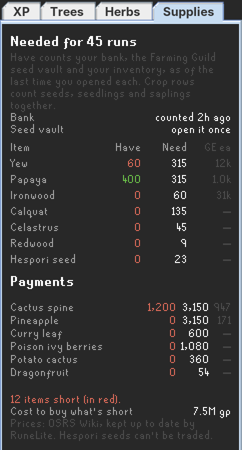

# Tree Running

Daily Farming tree runs and herb runs, planned and tracked toward a goal: a level (99 by default) or any XP total up to 200M. The plugin tells you what to bring, ticks off each patch as you do it, and keeps track of your XP, run times and profit.

## Install

In RuneLite, open the **Plugin Hub** (the wrench, then **Plugin Hub** at the bottom of the plugin list), search for **Tree Running** and press **Install**. A tree icon appears in the side bar.

## First-time setup

1. Open RuneLite's settings (the wrench), then **Tree Running**. Pick your goal and the crops you plant, untick tree patches you can't use, turn on your herb patches and pick a herb for each, and set your compost and diary bonuses.
2. **Open your bank and the Farming Guild seed vault once.** That's how the plugin learns what you have. Each updates every time you open it.
3. Open the tree icon and check your route in the **Route editor** at the bottom of the XP tab. Add bank stops where you restock. The travel notes assume a maxed house (jewellery box, portal nexus, spirit trees); type your own where yours differ.
4. Do your run. Patches tick themselves as you go. Press **Finish run** at the end.

## XP tab

- **Goal**: XP left, and how many days to get there with the tree and herb runs you do each day, with a goal date.
- **XP per run**: your average tree run, the planned run, the herb run estimate and the run in progress.
- **Profit**: lifetime and last-run profit for tree and herb runs. Harvests are valued at live prices, minus seeds, compost and payments. Tree runs count fruit and bark picked against each sapling's seed and the payments you made.
- **Tree run history**: XP, patches and time for each run, with your best time marked. Delete a run with its ✕.

- **Route editor**: move stops and the patches inside them with the arrows, edit the travel note under each stop, and add bank stops before or after any stop. Herb patch travel notes are editable at the bottom.

## Trees tab

- **Checklist** in route order, with your bank stops and travel notes. Checking a tree's health or planting it ticks that patch, in any order. Raking weeds doesn't. Opening your bank ticks the next bank stop.
- **Patch state**: each patch shows what it looked like when you last saw it: grown, check health, diseased, dead or a stump. A patch seen growing isn't due until it can have finished.
- **Payments**: when a gardener says "Leave it with me", that patch is marked paid (the Falador elite diary's free protection counts too). A planted patch that isn't paid is shown in orange and its gardener is outlined in game.
- **This run needs**: saplings, payments and tools for the patches left, against your inventory. An inventory-space warning tells you where to add a bank stop if the run won't fit in 28 slots.
- **Filter bank to this run**: shows only what the run needs when you open your bank.

## Herbs tab

- **This run needs** at the top: seeds, compost and tools for the patches that are ready, and a reminder if your magic secateurs aren't with you.
- **Patches**: every herb patch you've turned on, with its state (ready, diseased, dead, not seen yet) or time left, and the herb you chose for it. Allotments are one entry per location if you turn them on. DF marks disease-free patches.
- **Run checklist**: harvest, compost, plant and pay for each patch, ticked as you do them. Planting, the last pick and curing or clearing tick from the patch itself, each pick from its Farming XP, and compost from the "You treat the herb patch with..." message.

- **Profit: this run**: herbs picked at live prices, minus the seeds you planted, compost and allotment payments, each listed.
- **Herb run history**: XP, profit, herbs picked and time for each run.
- **Which herb pays best**: per patch at live prices, the herbs you'd pick on average minus the seed and compost, using your Farming level, compost, magic secateurs, Farming cape and diary bonuses.

## Supplies tab

- Seeds, saplings and protection payments for all the tree runs left to your goal, against your bank, the Farming Guild seed vault and your inventory, with live OSRS Wiki prices.
- Items you're short of are in red, with the cost to buy what's short.

## In game

- **Overlay**: the current stop with its patches, unpaid gardeners and herbs on the way.
- **Patch outlines**: due patches are outlined (the next tree patch in bright green), and gardeners you haven't paid are outlined in orange. An optional hint arrow points at the next patch.
- **Bank filter**: turn it on in the Trees or Herbs tab, or right-click the bank's **Show worn items** button.
- **Notification** when all your herb patches should be grown.

## Settings

All settings are in RuneLite's settings (the wrench, then **Tree Running**):

- **Goal**: a level or an XP total, tree and herb runs per day, and how many recent runs your average uses.
- **Tree crops** and **Tree patches**: the tree, fruit tree and hardwood you plant, and each patch on or off (26, including an optional crystal tree).
- **Herb runs**: compost, magic secateurs, Farming cape, Kandarin and Kourend diary bonuses, the allotment crop, paying to protect allotments, a notification when herbs are grown, herbs on the way (grown herb patches at Farming Guild, Catherby and Falador added to those tree-run stops, off by default), and **Don't count seed costs (ironman)** for accounts that get their seeds from drops and seed packs.
- **Herb patches**: each patch on or off, its herb, and its allotments.
- **Overlay and highlights**: the checklist overlay (always or only during a run), patch and gardener outlines, and the hint arrow.
- **Debug**: the debug log.

## How runs are counted

- A run starts at the first tick and ends when you press **Finish run**. Tree runs finish themselves 12 hours after the last tick, herb runs after 2 hours. The run's XP, time and profit then go to the history.
- Tree patches are timed from when you ticked them on a finished run and from what you last saw of them, so long-growing trees show as due only when they can be.
- Prices are the OSRS Wiki's live prices, which RuneLite downloads itself. Saplings aren't traded, so a planting costs its seed. Hespori seeds and crystal shards can't be traded.
- Progress, patch states, run history and bank and seed vault counts are saved per account in your RuneLite profile.

## Something not ticking?

Turn on **Debug log** in the plugin's settings and do a few runs. It writes Farming XP drops, patch changes and every tick decision to RuneLite's own log, `.runelite/logs/client.log`, on lines starting with `[Tree Running]`. Open an issue on this repository with that file and a note of which patches it missed.

## Data sources

Levels, XP, payments, growth times and herb yields come from the OSRS Wiki. Item IDs come from RuneLite's item list. Patch regions, varbits and patch states come from RuneLite's Time Tracking plugin.
